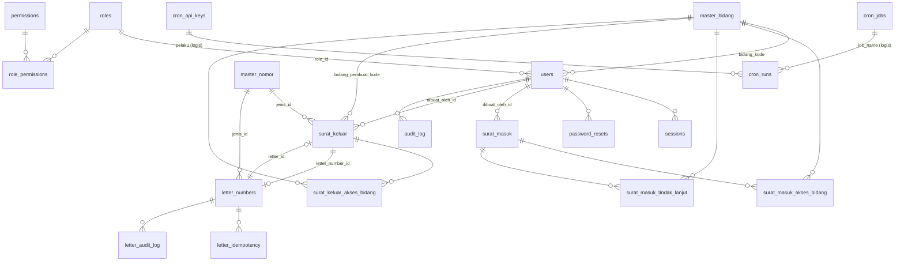

# Diagram ER — SiPrima MySQL

## Catatan desain

- **PK**: `BIGINT UNSIGNED AUTO_INCREMENT` untuk semua tabel internal. Alasan: InnoDB menyimpan baris berdasarkan PK pada clustered index, sehingga PK kecil dan monoton mempercepat insert/join serta memperkecil FK. `cron_runs.run_id` memakai `CHAR(36)` UUID sebagai identifier publik sesuai spesifikasi.
- **ID publik**: karena otorisasi ditegakkan di server (bukan kerahasiaan ID), ID numerik pada URL tidak membocorkan data. Setiap endpoint memuat baris lalu memeriksa hak akses.
- **Array → tabel relasi**: `aksesBidang` menjadi `surat_masuk_akses_bidang` / `surat_keluar_akses_bidang` dengan PK komposit + index `bidang_kode` untuk query `array-contains`.
- **Map dinamis → tabel**: `tindakLanjut` (map per bidang) menjadi `surat_masuk_tindak_lanjut` dengan `UNIQUE(surat_masuk_id, bidang_kode)`.
- **Map statis → kolom**: `dibuatOleh`, `disposisi`, `created_by`, `voided_by` menjadi kolom `*_id` + snapshot `*_nama`/`*_role`.
- **JSON**: `letter_audit_log.before_json/after_json`, `audit_log.sebelum/sesudah`, `cron_jobs.config`, `cron_api_keys.allowed_jobs`, `cron_runs.result` — strukturnya fleksibel dan tidak di-query.
- **FK actions**: `CASCADE` untuk anak yang tidak bermakna tanpa induk (relasi akses, tindak lanjut, audit surat), `SET NULL` untuk referensi opsional (user, bidang, jenis nomor, letter number), `RESTRICT` untuk role yang masih dipakai.
- **Waktu**: `DATETIME(3)` UTC; konversi zona Asia/Jakarta dilakukan di aplikasi (`src/utils/tanggal.js`).
